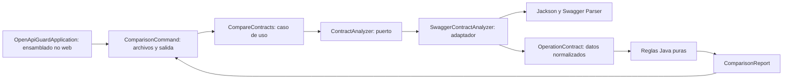

**Transición MIT (22 de octubre):** prepareAttributions incluye LICENSE.txt desde la licencia raíz y devuelve productLicenseStatus MIT, productLicenseFile y productLicenseSha256. prepare-evaluation.ps1 ya no copia términos de piloto; genera estados OPEN_SOURCE_LOCAL_PACKAGE u OPEN_SOURCE_CANDIDATE_PUBLICATION_PENDING. Las pruebas de atribuciones y paquete real comprueban MIT y ausencia de condiciones comerciales. El verificador de integridad conserva compatibilidad con paquetes históricos. prepare-test-delivery.mjs permanece como utilidad histórica, no como flujo actual. Ver [distribución actual](../open-source.md).

# Guía de lectura de todo el código

La [entrega de prueba de tienda](../test-store-delivery.md) añade prepare-test-delivery.mjs. Reempaqueta un motor ya verificado, conserva su procedencia y extrae la licencia aprobada sin copiar documentos privados. No es un build nuevo del motor ni una activación comercial.

El empaquetador incorpora [atribuciones offline](../third-party-review.md): prepare-attributions.mjs comprueba el catálogo versionado, binarios/fuentes/textos y loader; .gitattributes conserva sus bytes originales. Estas comprobaciones no cambian el motor ni conceden una licencia al producto.

Esta guía describe la implementación existente, sin adelantar funcionalidades del roadmap. El punto de partida es la CLI local: recibe dos contratos, produce un informe y termina. Spring Boot ensambla ese arranque; el dominio y la aplicación funcionan sin Spring.

Si quieres utilizar la herramienta en otro proyecto antes de leer su código, empieza por la [configuración mínima de GitHub Actions](../github-actions-quickstart.md).

El [registro de rc.2](../pilot-delivery.md) identifica el código estable integrado en main y el paquete verificado. El [plan de distribución pública](../commercial-launch.md) y la [revisión de terceros](../third-party-review.md) son documentación de la siguiente etapa; no añaden reglas, activación comercial ni pagos al código existente.

La integración GitHub incorpora [comentario actualizable de PR](../github-annotations.md#comentario-en-la-conversación-de-la-pr), opcional y exterior al motor. Ver pr-comment.mjs para renderizado, identidad del comentario, control de revisión y API; action-runner conserva los códigos y las rutas aunque falle la publicación.

La entrega del 16 de octubre mejora el [informe de PR](../github-annotations.md): contexto de operación, diferencias concretas de restricciones y consola por hallazgo. La Action permite configurar rupturas intencionadas mediante `fail-on-breaking`, conservando informe y revisión pendiente. No cambia la prueba de inclusión ni añade infraestructura.

La entrega del 10 de octubre añade [cuatro mejoras de uso](../product-usability.md), organiza el comando en parsing/presentación/escritura y valida el Javadoc público sin avisos. Los algoritmos de inclusión y normalización mantienen sus reglas y perfiles anteriores. El Javadoc generado incluye helpers internos para recorrer el código.

Para leerla como sitio visual, ver el [portal Docusaurus](../portal/documentation-site.md), con [explicación del producto](../portal/project.md), [roadmap actual](../portal/roadmap.md), catálogo y explorador local de código.

## Orden recomendado de revisión

1. [Flujo y contrato público](runtime.md): seguir una comparación desde los argumentos hasta el código de salida.
2. [Modelo y reglas del dominio](domain.md): entender los valores del informe y la dirección de compatibilidad.
3. [Algoritmo de inclusión](inclusion.md): revisar cómo se prueban restricciones conjuntas, objetos y arrays.
4. [Adaptador OpenAPI](openapi.md): comprobar validación, normalización, referencias y procedencia.
5. [Build, configuración y scripts](build.md): reproducir la ejecución y revisar su integración local con CI.
6. [Tests y ejemplos](tests.md): conocer los oráculos, las regresiones y lo que cubre cada batería.
7. [Inventario completo](inventory.md): localizar cada archivo de producción, método declarado, prueba y fixture.
8. [Cómo mantener y ampliar el código](maintenance.md): dónde intervenir y qué conservar.

Para una primera lectura basta con runtime.md y domain.md. Los tests parametrizados reutilizan unas pocas familias de escenarios; no hace falta leer las 942 ejecuciones para comprender el flujo. El [primer uso y las cuatro mejoras entregadas](../product-usability.md) ofrece ejemplos y explica las nuevas piezas CLI.

Las flechas representan llamadas y circulación de datos en ejecución. En compilación el adaptador depende del puerto y del dominio; el dominio no importa librerías del adaptador. No hay repositorios de persistencia, entidades JPA, servidor HTTP ni interfaces por cada regla.

## Vocabulario que aparece en el código

| Término | Significado |
| --- | --- |
| baseline / candidate | Contrato anterior y contrato propuesto, en ese orden. |
| source / target | Conjuntos usados por la prueba matemática de inclusión. En respuesta se invierte el orden de los contratos. |
| operation | Pareja de ruta literal y método HTTP. |
| profile | Cobertura versionada y explícita del análisis. `full` reúne las facetas implementadas. |
| definition pointer | JSON Pointer al nodo donde se define el dato, posiblemente en components. |
| usage pointer | JSON Pointer al lugar que utiliza esa definición. |
| representation issue | No se puede interpretar con seguridad la representación o negociación de ese uso. |
| unsupported / opaque | Restricción cuyo significado no se ha implementado; impide certificar ese análisis. |
| satisfiable | Hay evidencia de que el esquema admite al menos un valor. |
| witness | Valor o argumento que demuestra que la inclusión falla. |

El inventario cubre archivos versionados de código, recursos, scripts, build y ejemplos. `target/`, `.git/` y la configuración local del IDE son artefactos o estado local, no parte del código del producto. La documentación histórica de decisiones se conserva en [arquitectura](../architecture.md), [roadmap](../roadmap.md) y los documentos de perfiles enlazados desde el README principal.

## Comprobaciones de esta documentación

Se ha contrastado el inventario con los 146 archivos versionados de código, recursos, scripts, configuración raíz y ejemplos; se han comprobado sus enlaces locales. Las modificaciones Java se limitan a comentarios/Javadoc, conservando el código ejecutable. El Javadoc de producción se ha generado con Corretto 25 y doclint, sin enlaces externos ni descargas, mediante la [receta reproducible](build.md).

Verificación de entrega del 9 de octubre de 2026: `mvnd -o clean verify` y `mvn -o verify` pasan con 935 pruebas cada uno (910 habituales y 25 del JAR), sin fallos, errores ni omisiones. También pasan los diez escenarios de `scripts/test-ci.ps1`. Los resultados JUnit se consultan en los directorios descritos en [tests](tests.md); esta documentación explica su cobertura sin prometer todas las combinaciones del estándar.
