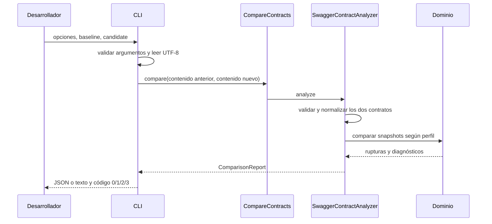

# Flujo, aplicación y CLI

La salida text incorpora [posiciones físicas del candidato](../source-locations.md) mediante CandidateSource en adapter.cli. ComparisonCommand reutiliza el texto leído; ReportRenderer muestra un renglón por hallazgo con definición y uso candidatos. JSON y semántica del motor permanecen estables.

## Seguir una ejecución

`OpenApiGuardApplication.main` crea streams UTF-8 para stdout/stderr, arranca un contexto Spring en modo `NONE`, obtiene `ComparisonCommand`, ejecuta la comparación, cierra el contexto y termina el proceso con el código devuelto. `start` apaga también el banner. Los métodos `comparison` y `command` declaran los dos beans exteriores. El bean de comparación utiliza el perfil histórico de parámetros.

`ComparisonCommand.execute` delega las opciones en `CliOptions`. Se mantienen dos archivos posicionales o se usan `--baseline=` y `--candidate=` sin mezclarlos. `--help` y `--list-profiles` no leen contratos. El formato puede ser JSON, texto o Markdown; `--output=` guarda el mismo contenido UTF-8. Opciones desconocidas, repetidas o una cantidad incorrecta de archivos generan ayuda en stderr y código 2. Ver [uso, objetivos y límites](../product-usability.md).

Sin opción de perfil se usa el caso de uso inyectado. Una selección explícita construye un `CompareContracts` con un `SwaggerContractAnalyzer` del perfil solicitado. Este pequeño ensamblado en el adaptador evita una fábrica o un contenedor adicional para siete opciones fijas.

`read` abre cada archivo, lee como máximo 5 MiB más un byte y decodifica UTF-8 estrictamente. Archivo ausente, permisos, ruta inválida, exceso de tamaño o UTF-8 inválido dan un informe `FAILED` con `INPUT_READ_FAILED`. La lectura es secuencial: si falla el primer archivo, no se llega a leer el segundo. Las reglas no abren archivos.

`CompareContracts.compare` recibe contenidos como strings y delega en el puerto `ContractAnalyzer`. El constructor exige un analizador no nulo; `profile` expone su cobertura. El puerto es funcional para facilitar dobles de prueba. Su método `profile` por defecto devuelve `OPERATIONS_ONLY`, conservando la semántica de implementaciones anteriores; el adaptador Swagger lo sobrescribe.

El adaptador valida y normaliza ambos documentos, ejecuta reglas habilitadas y agrega el informe. Un error de entrada impide producir eliminaciones especulativas. `ReportRenderer` conserva JSON/texto y añade Markdown con datos escapados. `ReportFiles` protege inputs/aliases y reemplaza el informe tras escribir un temporal; errores de guardado dan código 2. Los logs van a stderr.



## Perfiles públicos

Cada fila añade cobertura a la anterior. Los identificadores son parte del contrato público y aparecen en el informe. El orden del enum no debe emplearse como cálculo de capacidades: se utilizan sus métodos `includes...`.

| Opción CLI | Enum | Identificador | Cobertura añadida |
| --- | --- | --- | --- |
| operations | OPERATIONS_ONLY | operations-only-v1 | Disponibilidad de rutas y métodos. |
| parameters, predeterminado | PARAMETER_PRESENCE | operations-parameter-presence-v1 | Presencia obligatoria de parámetros soportados. |
| request-body | REQUEST_BODY | operations-parameters-request-body-v1 | Cuerpo obligatorio y cobertura de media types de petición. |
| schema-values | SCHEMA_VALUES | operations-parameters-schema-values-v1 | Tipos, enums, nullabilidad y límites escalares conjuntos. |
| schemas | OBJECT_SCHEMAS | operations-parameters-object-schemas-v1 | Propiedades, required y additionalProperties booleano. |
| arrays | ARRAY_SCHEMAS | operations-parameters-array-schemas-v1 | Arrays homogéneos, items, minItems/maxItems. |
| full | RESPONSE_POLICY | operations-data-response-policy-v1 | Política de disponibilidad de códigos y representaciones de respuesta. |

`ComparisonProfile.excludedFacets` conserva el listado explícito de exclusiones de cada versión. Incluso `full` excluye facetas: composición, negociación efectiva, seguridad y otros aspectos no implementados. Una faceta excluida no equivale a un diagnóstico; una construcción opaca encontrada dentro de los datos comprometidos sí puede hacer parcial el análisis. Consultar los documentos [de perfiles](../../README.md) para sus políticas completas.

## Informe y salida

| Situación | status | verdict | Código CLI |
| --- | --- | --- | --- |
| Sin rupturas ni diagnósticos | COMPLETED | COMPATIBLE | 0 |
| Ruptura demostrada, sin lagunas | COMPLETED | BREAKING | 1 |
| Ruptura demostrada y lagunas | PARTIAL | BREAKING | 1 |
| Sin prueba de ruptura, pero con lagunas | PARTIAL | INDETERMINATE | 3 |
| Entrada fallida | FAILED | INDETERMINATE en el flujo normal | 2 |

El código 1 prevalece sobre la revisión cuando existe una ruptura probada. El código 2 prevalece si el estado es FAILED. `ComparisonReport.of` calcula estos valores; su constructor público no valida todas las combinaciones posibles. Un fallo al serializar da código 2 y un mensaje en stderr. El código 0 certifica únicamente el perfil seleccionado.

## Ejecutar un ejemplo y depurarlo

```powershell
mvnd -o clean verify
java -jar target/openapi-breaking-change-guard-0.1.0-SNAPSHOT.jar --profile=full --format=text examples/catalog/base.yaml examples/catalog/breaking.yaml
$LASTEXITCODE
```

El catálogo breaking debe dar cuatro hallazgos y código 1. Para seguirlo en IntelliJ: poner breakpoints en `ComparisonCommand.execute`, `SwaggerContractAnalyzer.analyze`, `SchemaValuesRule.compare` y `SchemaInclusion.compare`. Para un código eliminado, seguir `ResponsePolicyRule.compare`.

Los cuatro hallazgos permiten relacionar el informe con el código:

| Operación y dato | Regla | Definición localizada |
| --- | --- | --- |
| POST /orders, quantity de petición | REQUEST_SCHEMA_VALUES_RESTRICTED | /components/schemas/CreateOrder/properties/quantity |
| POST /orders, status de respuesta | RESPONSE_SCHEMA_VALUES_EXPANDED | /components/schemas/Order/properties/status |
| GET /orders/{orderId}, status de respuesta | RESPONSE_SCHEMA_VALUES_EXPANDED | /components/schemas/Order/properties/status |
| GET /products, tamaño de lista de respuesta | RESPONSE_SCHEMA_VALUES_EXPANDED | /paths/~1products/get/responses/200/content/application~1json/schema |

Los dos usos de Order producen identidades distintas aunque su definición sea común. Los pointers de uso distinguen las operaciones afectadas; los de definición permiten abrir directamente la restricción. En el último pointer, `~1products` corresponde a la ruta `/products` y `application~1json` al formato `application/json`.

También se puede utilizar la comparación dentro de Java, con el classpath del proyecto y sin arrancar Spring:

```java
var comparison = new CompareContracts(
        new SwaggerContractAnalyzer(ComparisonProfile.RESPONSE_POLICY));
ComparisonReport report = comparison.compare(baselineContent, candidateContent);
```

Imports: `com.openapiguard.application.CompareContracts`, `com.openapiguard.adapter.openapi.SwaggerContractAnalyzer`, `com.openapiguard.domain.ComparisonProfile` y `com.openapiguard.domain.ComparisonReport`. Los argumentos son contenidos UTF-8 ya decodificados, no rutas. No existe aún una distribución independiente como librería publicada; el ejemplo muestra el ensamblado de las clases actuales.
