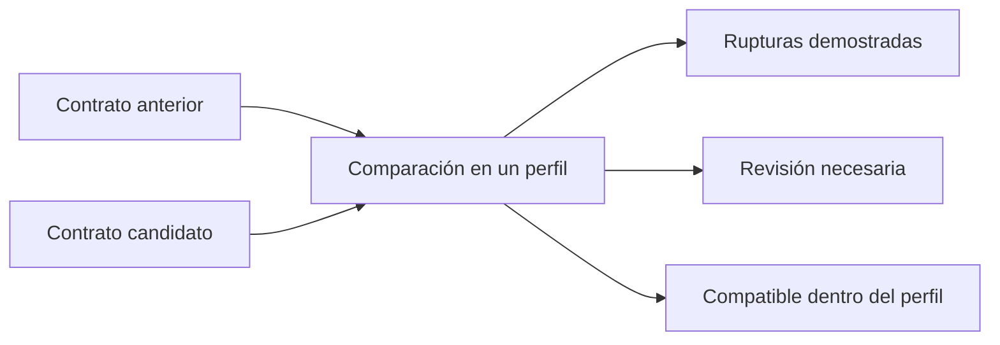

Código propio gratuito bajo [MIT](../../LICENSE). Las bibliotecas conservan sus licencias. Ver [distribución actual](../open-source.md).

# Qué es OpenAPI Breaking Change Guard

OpenAPI Guard compara dos contratos OpenAPI y explica qué cambios pueden romper a sus consumidores. El contrato anterior es la base; el propuesto es el candidato. El producto está pensado para que un equipo detecte una incompatibilidad antes de publicar una nueva versión de su API.

Hoy es una **CLI local**, con un motor Java independiente de Spring y un arranque Spring Boot no web. Lee dos archivos JSON/YAML, imprime un informe JSON, texto o Markdown y termina con un código que puede utilizar CI. Admite contratos por nombre, informes a archivo y un lanzador con demo. La salida de texto ubica cada ruptura en el candidato; ver [posiciones y límites](../source-locations.md). No requiere servidor, cuentas, base de datos ni infraestructura cloud.

## Qué problema resuelve

Una API puede compilar y seguir respondiendo HTTP aunque haya roto su contrato. Un nuevo parámetro obligatorio puede rechazar clientes anteriores; una respuesta que ahora permite un valor inesperado puede romper un consumidor. Revisar estos cambios a mano es difícil porque el significado depende de la dirección del dato y de varias restricciones combinadas.

El informe incluye identificador estable, regla, severidad, operación afectada, definición y uso originales, descripción, estado, perfil y exclusiones.

## Qué hace actualmente

| Área | Cobertura implementada |
| --- | --- |
| Operaciones | Endpoint o método HTTP eliminado; plantillas ambiguas como revisión. |
| Parámetros | Herencia y override; nuevo obligatorio y opcional → obligatorio. |
| Cuerpos | Obligatoriedad y formatos de petición, con política conservadora por método. |
| Datos | Tipos, enums, nullabilidad y límites numéricos/de longitud conjuntos. |
| Objetos | Properties, required, additionalProperties booleano y proyección readOnly/writeOnly. |
| Arrays | Items homogéneos, anidamiento y minItems/maxItems. |
| Respuestas | Política documental de retirada de códigos/formatos; adiciones y fallback revisables. |
| Automatización | JAR ejecutable, salida estructurada y scripts PowerShell verificados. |

Utilizar `--profile=full` para toda esta cobertura. El predeterminado conserva el perfil histórico de presencia de parámetros. Se admiten contratos 3.0.x o 3.1.x de la misma familia; no se convierten dialectos entre sí.

## Qué significa el resultado

**COMPATIBLE** exige análisis completado sin rupturas dentro del perfil. **BREAKING** significa que existe una ruptura demostrada, aunque otras partes requieran revisión. **INDETERMINATE** significa que la evidencia no permite decidir. Un error de entrada no genera hallazgos especulativos.

Una comparación sin hallazgos no certifica automáticamente toda la API. Composición, ciclos, negociación efectiva, seguridad y otras facetas tienen límites explícitos. Los casos desconocidos del fragmento comprometido permanecen visibles.

## Qué queremos convertir en producto

La primera oferta comercial propuesta es una herramienta de guardia de contratos con onboarding y soporte manual, antes de construir una plataforma SaaS completa. El JAR y los tests son evidencia técnica; todavía falta validar utilidad con contratos reales, disposición a pagar y uso repetido.

Las integraciones GitHub y la gestión centralizada son evolución condicionada a necesidades de clientes. Ver [roadmap actual y futuro](roadmap.md), [primer uso](getting-started.md) y [mejoras propuestas](improvements.md).
